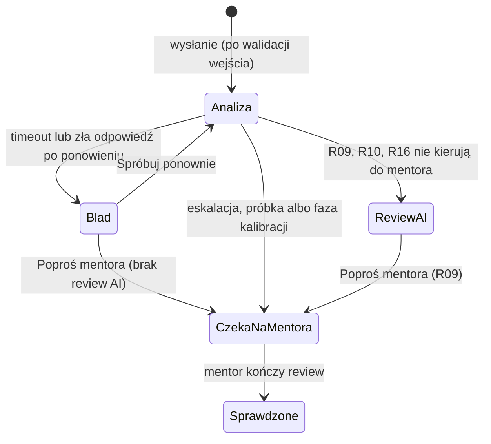

# Review-first Mentoring — rdzeń AI i UX (om-ux-shape, tryb Shape)

- Date: 2026-10-15; Owner: Adrian Czyrek
- Wejście: `.ai/specs/product-brief.md` (potwierdzony, D23–D26)
- Czytelnik: osoba, która napisze `KONCEPCJA.md` (Etap 1) i zbuduje klikalne mockupy (Etap 2, D03), bez udziału w discovery
- Kontrakt projektowy: brak (`.uxproof/` nie istnieje), więc nazwy komponentów są opisowe, nie z rejestru. `[PRODUCT]` oznacza tu decyzję z briefu (Rxx, Dxx).
- Status: kierunek zaakceptowany przez właściciela 2026-10-15 (punkty 1–4, O1, O2 — sekcja „Decyzje właściciela”). Podstawa Etapu 1.

## 🎯 Rekomendacja

Junior od razu widzi review AI. Status zgłoszenia ma jedną neutralną etykietę „Czeka na mentora”, taką samą przy eskalacji, próbce i w fazie kalibracji. Junior nie widzi pewności modelu w żadnej formie. Mentor ocenia każdą uwagę AI bez pewności modelu na ekranie i widzi ją dopiero po swojej decyzji. Każdą odpowiedź modelu kod sprawdza w całości: jeśli nie przejdzie walidacji, junior nie dostaje części review, tylko błąd z drogą dalej. Widok „Jakość AI” zaczyna się od stanu obu kryteriów porzucenia, a każda liczba ma obok swoje n.

Decydujący kompromis: ukrycie pewności przed decyzją mentora spowalnia mu ustalanie, które uwagi sprawdzić najpierw. W zamian oceny mentora nie zależą od pewności modelu. Bez tego test A03 („czy pewność odróżnia trafne uwagi od błędnych”) potwierdzałby sam siebie: mentor, który widzi 0,95, łatwiej zatwierdza. Przy konflikcie celów wygrywa nauka AI engineeringu (D08). `[RESEARCH]` efekt zakotwiczenia (Tversky i Kahneman, 1974) i automation bias (Parasuraman i Manzey, *Human Factors*, 2010)

## 📝 Problem i dowody

- **Junior** po wysłaniu kodu musi wiedzieć, którym uwagom ufać od razu, a które mogą się jeszcze zmienić. W fazie kalibracji (pierwsze 50 zgłoszeń, R16) każde jego zgłoszenie czeka na mentora. Etykieta, która sugeruje „masz poważny problem”, przy każdym zgłoszeniu wprowadzałaby w błąd. `[ASSUMPTION]`
- **Mentor** musi szybko i spójnie ocenić uwagi AI na telefonie (R07). Jego decyzje są jedynym źródłem etykiet dla evals (R05, R14), więc niespójne użycie „popraw” i „dodaj uwagę” psuje metryki (A05). `[ASSUMPTION]`
- **Właściciel** decyduje o rewizji koncepcji na podstawie małych próbek (30 uwag, 10–20 zgłoszeń). Wynik bez n albo „za mało danych” ukryte za liczbą prowadzi do decyzji na szumie. `[PRODUCT]` R17, R19
- Stan wiedzy: problem juniorów i mentorów jest niesprawdzony (A01, A02, zaakceptowane bez testu w D12). Nie ma danych o opóźnieniach modelu, odsetku błędnego JSON ani o tym, jak `confidence` ma się do trafności (A03). Wszystkie liczby graniczne w tym dokumencie, które nie pochodzą z briefu, to założenia.

## 🎯 Wyniki

- **Dla juniora:** rozumie, co poprawić i dlaczego, i wie, czy uwaga jest już sprawdzona przez mentora. MVP tego nie mierzy, bo A01 pozostaje niesprawdzone. Mierzymy tylko jakość uwag, które junior dostaje.
- **Co obserwujemy:** precyzja luźna i recall na próbce, z n (D13, R17). Oba kryteria porzucenia w stanie odczytywalnym bez liczenia ręcznego.
- **Efekt dla celu właściciela:** działający cykl evals (prompt → review → ocena mentora → metryka). Daje naukę AI engineeringu (D08) i odpowiedź, czy produkt warto rozwijać.
- **Co nie może się pogorszyć:** odsetek eskalacji. Jeśli zbliży się do 100% poza fazą kalibracji, mentor robi wszystkie review i A02 traci sens. Wskaźnik bez progu, pokazany w widoku „Jakość AI”. `[ASSUMPTION]` propozycja z briefu

## 📋 Zakres

**Teraz** (ponad zakres Now z briefu dokładamy tylko to, czego wymaga ta koncepcja):
- 7 ekranów opisanych niżej, każdy ze stanami ładowania, pustym, błędu i sukcesu.
- Walidacja wejścia przed wywołaniem modelu: link, prywatny PR, za duży diff.
- Walidacja całej odpowiedzi modelu, jedno automatyczne ponowienie, błąd z drogą dalej; surowe niepoprawne odpowiedzi w logu.
- `prompt_version` zapisywane przy każdym review; metryki i kryterium precyzji liczone per wersja.
- Pewność ukryta przed mentorem do jego decyzji.
- W „Jakość AI”: tabela „Pewność a trafność” (bezpośredni test A03 i podstawa ponownej kalibracji progu 0,7, D17) i licznik błędów modelu (D08).

**Później:** podgląd logu niepoprawnych odpowiedzi w UI; lista i eksport przypadków testowych (JSON) do ponownego uruchamiania promptu; pomiar czasu review mentora (test A02); opcjonalny powód odrzucenia uwagi; historia zmian decyzji mentora; GitHub OAuth dla prywatnych PR.

**Nie robimy:** N01–N05 z briefu. Do tego: filtrów i sortowania w kolejce mentora (jeden mentor, kolejka od najstarszego), częściowego review przy za dużym diffie, pokazywania juniorowi pewności w jakiejkolwiek formie (D07), czatu z AI o uwadze.

## 📋 Jak to działa

### Słownik etykiet w UI (R07: UI po polsku)

| W danych | W UI |
|---|---|
| `readability` / `correctness` / `security` / `testing` / `architecture` | Czytelność / Poprawność / Bezpieczeństwo / Testy / Architektura |
| `info` / `minor` / `major` / `critical` | Informacja / Drobna / Istotna / Krytyczna |
| `confidence` | Pewność modelu (format `0,62`, tylko mentor, tylko po decyzji) |

Waga ma zawsze tekst, nie tylko kolor. Kolejność uwag na każdym ekranie: od najwyższej wagi, potem plik i linia.

### Statusy zgłoszenia



Kod rozstrzyga przejście z „Analiza” od razu po walidacji odpowiedzi (R09, R10, R16). Junior nigdy nie widzi stanu pośredniego „review AI bez decyzji o mentorze”.

| Status | Odznaka u juniora | Odznaka u mentora |
|---|---|---|
| Analiza | „Analizuję kod” | — (nie ma w kolejce) |
| Błąd | „Review nie powiodło się” | — |
| Review AI | „Review AI” | — |
| Czeka na mentora | „Czeka na mentora” | „Do oceny” |
| Sprawdzone | „Sprawdzone przez mentora” | „Zakończone” |

### J1 — „Moje zgłoszenia” (junior, ekran startowy)

Nagłówek „Moje zgłoszenia”, przycisk główny „Nowe zgłoszenie”. Lista kart: opis celu (pierwsze 80 znaków), źródło („PR: repo#12” albo „Fragment kodu”), data, odznaka statusu, liczba uwag („4 uwagi: 1 istotna, 3 drobne”). Dotknięcie karty prowadzi do J3.

| Stan | Co widzi junior |
|---|---|
| Ładowanie | 3 szare karty-szkielety |
| Pusty | „Nie masz jeszcze zgłoszeń. Wyślij link do PR albo fragment kodu i opisz, co chcesz osiągnąć — dostaniesz review z wyjaśnieniem, co i dlaczego poprawić.” + „Nowe zgłoszenie” |
| Błąd | „Nie udało się wczytać zgłoszeń.” + „Spróbuj ponownie” |
| Sukces | Lista kart |

### J2 — „Nowe zgłoszenie” (junior)

Przełącznik dwóch zakładek: „Link do PR” | „Fragment kodu”. Pole wspólne: „Co chcesz osiągnąć?” (wymagane, min. 10 znaków, podpowiedź: „Np. dodaję logowanie przez e-mail i nie wiem, czy dobrze obsługuję błędy”). Przycisk „Wyślij do review”. Treść pól zostaje przy przełączaniu zakładek i przy każdym błędzie.

Walidacja (komunikat pod polem, fokus wraca na pole):

| Przypadek | Kiedy wykrywamy | Komunikat | Droga dalej |
|---|---|---|---|
| Zły format linku | w przeglądarce | „To nie jest link do pull requesta na GitHubie. Przykład: https://github.com/uzytkownik/repo/pull/12” | poprawić link |
| Prywatny lub nieistniejący PR | serwer, przy wysłaniu (GitHub zwraca 404 w obu przypadkach) | „Nie mamy dostępu do tego PR. Jest prywatny albo link jest błędny. Wklej kod jako fragment albo podaj link do publicznego PR.” | link „Wklej fragment kodu” przełącza zakładkę, opis celu zostaje |
| Za duży diff | serwer, przed wywołaniem modelu | „Ten PR zmienia 1 240 linii, a limit to 400. Podziel zmianę na mniejsze PR albo wklej fragment, który chcesz omówić.” | jak wyżej |
| Za długi fragment | w przeglądarce | „Fragment ma 520 linii, a limit to 400. Wklej część, o którą chcesz zapytać.” | skrócić |
| PR bez zmian w plikach tekstowych | serwer | „W tym PR nie ma zmian w kodzie, które możemy przeczytać.” | inny link lub fragment |
| Pusty opis celu | w przeglądarce | „Opisz w kilku słowach, co chcesz osiągnąć (min. 10 znaków).” | uzupełnić |

Nie przycinamy za dużego diffu po cichu. Review części zmiany wyglądałoby jak pełne i ukryłoby przeoczenia (A04). Limit 400 linii (dodane + usunięte) to założenie do sprawdzenia na golden secie (budżet tokenów, czas odpowiedzi).

Stan wysyłania: przycisk zmienia się na „Sprawdzam PR…” i jest zablokowany. Po przejściu walidacji zgłoszenie powstaje, a junior trafia na J3 w stanie „Analizuję kod”.

### J3 — „Review” (junior)

Przyklejony nagłówek: opis celu, odznaka statusu. Pod nim baner zależny od statusu, potem lista kart uwag.

**Karta uwagi (junior):** linia meta „Istotna · Bezpieczeństwo · auth.ts:42”, tytuł (do 80 znaków), sekcja „Dlaczego:” z wyjaśnieniem. Fragment kodu z linią, której dotyczy uwaga (±2 linie, tylko do odczytu). Bez pewności modelu.

| Status | Baner | Akcje |
|---|---|---|
| Analizuję kod | Szkielet listy + „AI czyta kod i cel zgłoszenia. Zwykle trwa to do minuty. Możesz zamknąć stronę — wynik znajdziesz w „Moje zgłoszenia”.” Po pierwszej nieudanej próbie: „Pierwsza próba się nie udała, próbuję jeszcze raz…” | — |
| Review AI | brak banera | „Poproś mentora o sprawdzenie” (przycisk drugorzędny pod listą) → potwierdzenie „Mentor sprawdzi to review. Uwagi mogą się zmienić.” [„Poproś mentora”] [„Anuluj”] → status „Czeka na mentora” |
| Czeka na mentora | „**Czeka na mentora.** Mentor sprawdzi te uwagi. Do tego czasu traktuj je jako wstępne — mogą się zmienić albo zniknąć. Część zgłoszeń trafia do mentora losowo, więc ta etykieta nie oznacza, że kod jest gorszy.” | brak (nie ma „Poproś mentora”) |
| Czeka na mentora, AI bez uwag (R10) | „**Czeka na mentora.** AI nie znalazło uwag do tego kodu. Mentor sprawdzi, czy czegoś nie przeoczyło.” | — |
| Czeka na mentora, bez review AI (po błędzie) | „**Czeka na mentora.** Review AI się nie udało, więc mentor zrobi je od początku.” | — |
| Sprawdzone przez mentora | „**Sprawdzone przez mentora** 15 paź, 14:20.” | — |
| Błąd | patrz „Błędy modelu” | „Spróbuj ponownie”, „Poproś mentora” |

Ten sam baner „Czeka na mentora” obowiązuje przy eskalacji, próbce i w fazie kalibracji. Junior nie dostaje osobnego komunikatu o fazie kalibracji (R12). Zdanie o losowym wyborze jest prawdziwe w każdej fazie i nie zdradza, z którego strumienia pochodzi dane zgłoszenie. `[ASSUMPTION]` zgodność z R12 do potwierdzenia (O7)

**Wersja sprawdzona.** Każda karta dostaje oznaczenie pochodzenia:
- „Potwierdzone przez mentora”: treść AI bez zmian.
- „Poprawione przez mentora”: pokazuje wersję mentora, pod nią rozwijane „Pokaż pierwotną wersję AI”.
- „Dodane przez mentora”: uwaga, której AI nie zgłosiło.
- Odrzucone uwagi przechodzą do zwiniętej sekcji na końcu: „Odrzucone przez mentora (2) — uznane za nietrafne, nie musisz ich poprawiać.”

Stany ekranu: ładowanie (szkielet), błąd wczytania („Nie udało się wczytać review.” + „Spróbuj ponownie”), brak dostępu (zgłoszenie innego juniora: „To zgłoszenie nie jest Twoje.” + „Wróć do moich zgłoszeń”).

### M1 — „Kolejka” (mentor)

Nagłówek „Kolejka”. Pod nim pasek fazy: „Faza kalibracji: 23 z 50 zgłoszeń — wszystkie trafiają do Ciebie” albo, po fazie, „Próbka: 20% zgłoszeń bez eskalacji”. Lista od najstarszego. Karta: opis celu, junior, data, odznaka strumienia „Eskalacja” albo „Próbka”, powody, „5 uwag AI” albo „Bez uwag AI”.

Powody (wylicza je kod, może być kilka naraz):

| Warunek | Etykieta |
|---|---|
| uwaga `critical` (R09) | „Uwaga krytyczna” |
| `architecture` ≥ `major` (R09) | „Architektura: istotna lub krytyczna” |
| uwaga ≥ `major` z `confidence` < 0,7 (R09) | „Niska pewność przy istotnej uwadze” |
| junior poprosił (R09) | „Prośba juniora” |
| brak uwag AI (R10) | „Brak uwag AI” |
| błąd modelu + prośba juniora | „Brak review AI (błąd modelu)” |
| losowanie 20% (R16) | „Próbka losowa” |
| nieeskalowane w pierwszych 50 (R16, D24) | „Faza kalibracji” |

Strumień: zgłoszenie z dowolnym powodem R09/R10 to „Eskalacja”. Dwa ostatnie powody to „Próbka”. Powód „Niska pewność” jest na poziomie zgłoszenia i nie wskazuje, której uwagi dotyczy (spójnie z ukryciem pewności w M2).

| Stan | Co widzi mentor |
|---|---|
| Ładowanie | szkielety kart |
| Pusty | „Kolejka jest pusta. Zgłoszenia pojawią się tu, gdy wskaże je reguła eskalacji albo próbka losowa.” |
| Błąd | „Nie udało się wczytać kolejki.” + „Spróbuj ponownie” |
| Brak uprawnień (junior) | „Ten widok jest dla mentora.” + „Wróć do moich zgłoszeń” |

### M2 — „Ocena zgłoszenia” (mentor)

Przyklejony nagłówek: opis celu, odznaki strumienia i powodów, licznik „Ocenione: 3 z 5”. Pod nim przełącznik „Uwagi” | „Cały kod” (na telefonie kod i uwagi nie mieszczą się obok siebie). W „Cały kod” numery linii, uwagi AI oznaczone przy liniach.

**Karta uwagi AI (mentor)** przed decyzją: meta, tytuł, „Dlaczego:”, kontekst kodu i trzy przyciski o tej samej szerokości: „Zatwierdź” | „Popraw” | „Odrzuć” (min. 44 × 44 px). Pewności modelu nie ma na karcie.

Po decyzji karta się zwija: „✓ Zatwierdzona” / „✎ Poprawiona” / „✕ Odrzucona”, a obok link „Zmień”. Dopiero teraz pojawia się „Pewność modelu: 0,62 · poniżej progu 0,7” (albo „0,88”). Zmiana decyzji jest możliwa do „Zakończ review” i nadpisuje przypadek testowy tej uwagi zamiast tworzyć drugi.

- **Zatwierdź:** zapisuje przypadek testowy (R05) od razu, bez potwierdzenia.
- **Odrzuć:** to samo. Bez pola powodu (nie ma go w regułach, patrz „Później”).
- **Popraw:** otwiera arkusz „Popraw uwagę” wypełniony polami AI: Kategoria, Waga, Plik i linia, Tytuł, Dlaczego. Walidacja R15 (D25). Zapis bez żadnej zmiany jest zablokowany: „Brak zmian. Jeśli uwaga AI jest trafna, wybierz „Zatwierdź”.”
- **„+ Dodaj uwagę, której AI nie zgłosiło”** (przycisk pod listą): otwiera pusty arkusz „Nowa uwaga”. Pod tytułem arkusza tekst pomocy: „Każda dodana uwaga liczy się jako przeoczenie AI. Jeśli chcesz zmienić istniejącą uwagę, użyj „Popraw” przy niej.” (R14, A05)

**Walidacja arkusza** (Popraw i Nowa uwaga, R15):

| Pole | Reguła | Komunikat |
|---|---|---|
| Kategoria | wymagana | „Wybierz kategorię.” |
| Waga | wymagana | „Wybierz wagę.” |
| Linia | wymagana, w zakresie kodu; w PR także plik | „Podaj linię od 1 do 84.” |
| Dlaczego | twarda walidacja, min. 20 znaków | „Napisz, dlaczego to ważne — co najmniej 20 znaków (teraz 12).” Licznik „12/20” pod polem |
| Gotowy kod | ostrzeżenie, nie blokada | Po „Zapisz”: „To wygląda na gotowy kod. Junior powinien dostać wyjaśnienie, nie rozwiązanie.” Przyciski [„Zapisz mimo to”] [„Wróć do edycji”] |

Ostrzeżenie o kodzie uruchamia heurystyka: blok ``` albo co najmniej 2 linie wyglądające jak kod (średnik lub klamra na końcu, `=>`, `def `, `function`, `return `). `[ASSUMPTION]` Fałszywe ostrzeżenie jest tanie (jedno dotknięcie), przeoczony kod nie blokuje i tak (R15).

**Zakończenie:** przycisk „Zakończ review” na dole, przyklejony.
- Gdy zostały nieocenione uwagi, przycisk jest nieaktywny, a obok widać: „Oceń jeszcze 2 uwagi AI, żeby zakończyć.”
- Zgłoszenie bez uwag AI (R10) albo bez review AI: zamiast listy „AI nie zgłosiło żadnych uwag. Dodaj uwagi, jeśli coś przeoczyło, albo zakończ review.”, a przycisk aktywny od razu.
- Potwierdzenie: „Zakończyć review? Junior zobaczy wersję sprawdzoną. Po zakończeniu nie zmienisz już decyzji.” [„Zakończ”] [„Wróć”].
- Sukces: powrót do M1 z komunikatem „Review zakończone. Junior widzi wersję sprawdzoną.”

Stany: ładowanie (szkielet), błąd wczytania („Nie udało się wczytać zgłoszenia.” + „Spróbuj ponownie”), błąd zapisu akcji („Nie udało się zapisać decyzji. Spróbuj ponownie.”; karta wraca do stanu przed decyzją, nic nie znika po cichu), zgłoszenie już zakończone (tylko do odczytu, z pewnościami widocznymi przy wszystkich uwagach).

### E1 — „Jakość AI” (mentor i właściciel)

Pasek fazy jak w M1. Obok wybór wersji: „Wersja promptu: v3 · iteracja 2” z listą wszystkich wersji i opcją „Wszystkie wersje”. Domyślnie wybrana jest wersja, na której liczy się kryterium precyzji (najnowsza z co najmniej 30 ocenionymi uwagami z próbki), a gdy takiej nie ma — najnowsza. Sekcje 2 i 3 liczą się dla wybranej wersji. Liczymy tylko zakończone review (decyzje zmienione przed zakończeniem się nie liczą).

**Wersje i iteracje (O1).** Każde review AI zapisuje `prompt_version`. Nowa wersja powstaje przy każdej zmianie promptu lub modelu; v1 to stan początkowy, a każda zmiana to jedna iteracja (v2 = iteracja 1, v4 = iteracja 3). Ponowienie po błędzie używa tej samej wersji. Przypadki testowe dziedziczą wersję review, którego dotyczą.

**Sekcja 1 — „Kryteria porzucenia”**, dwie karty, pod każdą „Decyzję o rewizji podejmuje właściciel.” System niczego nie wyłącza.

Karta „Precyzja luźna na próbce ≥ 60%” (D13, R19, O1). 30 ocenionych uwag AI z próbki liczy się osobno dla każdej wersji promptu. Wynik liczymy na najnowszej wersji, która ma co najmniej 30 takich uwag; ocena kryterium wymaga dodatkowo co najmniej 3 iteracji:

| Warunek | Odznaka | Tekst |
|---|---|---|
| żadna wersja nie ma 30 ocenionych uwag z próbki | „Za mało danych” | „v3: 12 z 30 ocenionych uwag AI z próbki · iteracja 2 z 3. Przeoczenia się tu nie liczą.” |
| jest wersja z ≥ 30 uwagami, ale < 3 iteracje | „Za mało danych” | „v2: precyzja luźna 66% (n = 31) — wynik orientacyjny. Ocena kryterium od 3. iteracji (teraz 1).” |
| ≥ 3 iteracje, wersja z ≥ 30 uwagami, ≥ 60% | „Spełnione” | „v4: precyzja luźna 72% (n = 34) — powyżej progu 60%.” |
| ≥ 3 iteracje, wersja z ≥ 30 uwagami, < 60% | „Rewizja koncepcji” | „v4: precyzja luźna 54% (n = 31) — poniżej progu 60%. Kryterium mówi: rewizja koncepcji.” |

Gdy najnowsza wersja zbiera jeszcze dane, pod tekstem drobna linia: „v5 zbiera dane: 8 z 30.” Wynik nowej wersji zastępuje poprzedni dopiero po 30 uwagach.

Karta „Przeoczenia istotne lub krytyczne w ≤ 25% zgłoszeń z próbki” (D16, R19). Liczona łącznie dla wszystkich wersji (O8). n = zakończone zgłoszenia z próbki, licznik = zgłoszenia z co najmniej jedną uwagą mentora ≥ `major`:

| n | Wynik | Odznaka | Tekst |
|---|---|---|---|
| < 10 | — | „Za mało danych” | „6 z 10 zgłoszeń z próbki potrzebnych do pierwszego odczytu.” |
| 10–19 | ≤ 25% | „Wstępnie w normie” | „2 z 14 zgłoszeń (14%). Decyzja od 20 zgłoszeń.” |
| 10–19 | > 25% | „Ostrzeżenie” | „5 z 14 zgłoszeń (36%) ma dodaną uwagę istotną lub krytyczną. Decyzja od 20 zgłoszeń.” |
| ≥ 20 | ≤ 25% | „Spełnione” | „4 z 24 zgłoszeń (17%).” |
| ≥ 20 | > 25% | „Rewizja koncepcji” | „7 z 22 zgłoszeń (32%) — powyżej progu 25%. Kryterium mówi: rewizja koncepcji.” |

Od n ≥ 10 pod tekstem drobna linia: „Jedno zgłoszenie zmienia ten wynik o 4,5 pp.” (100 / n, zaokrąglone do 0,5). Nawet tuż po progu 20 wynik jest wrażliwy (brief, Kill criteria). Odznaki zawsze mają tekst, nie tylko kolor.

**Sekcja 2 — „Metryki”**, tabela:

| Metryka | Próbka | Eskalacje (diagnostycznie) |
|---|---|---|
| Precyzja ścisła | „61% · n = 34” | „48% · n = 52” |
| Precyzja luźna | „72% · n = 34” | „63% · n = 52” |
| Recall (szacunkowy) | „81% · n = 26”; przy n < 10: „3 przeoczenia · recall od n = 10 (teraz 7)” | „Nie liczymy — tylko na próbce. Przeoczenia: 5” |

n przy precyzji = ocenione uwagi AI, n przy recall = trafne uwagi AI + przeoczenia (D24). Pod tabelą: „Eskalacje: 38% zgłoszeń (19 z 50)” (wskaźnik bez progu).

**Sekcja 3 — „Pewność a trafność”**. Wszystkie strumienie, zakończone review, wybrana wersja (pewność nowego modelu lub promptu może znaczyć co innego). Wiersze: „poniżej 0,5”, „0,5–0,69”, „0,7–0,89”, „0,9 i więcej”. Kolumny: „Uwagi (n)”, „Trafne (zatw. + popr.)”, „w tym istotne i krytyczne: trafne / n”. Podpis: „Jeśli trafność nie rośnie z pewnością, warunek pewności w regule eskalacji niewiele daje.” Komórka z n < 5 pokazuje tylko n.

**Sekcja 4 — „Błędy modelu”**, dla wybranej wersji: „58 wywołań · udane za pierwszym razem 52 · udane po ponowieniu 4 · przekroczony czas 1 · niepoprawna odpowiedź 1”.

| Stan | Co widać |
|---|---|
| Ładowanie | szkielety kart i tabeli |
| Pusty (0 zakończonych review) | „Brak danych. Metryki pojawią się po pierwszym zakończonym review mentora.” Karty kryteriów w stanie „Za mało danych” z licznikami 0 |
| Błąd | „Nie udało się policzyć metryk.” + „Spróbuj ponownie” |
| Brak uprawnień (junior) | „Ten widok jest dla mentora.” |

### Mockupy (Etap 2, D03)

Przełącznik roli w nagłówku: „Junior” | „Mentor”. Nawigacja juniora: „Moje zgłoszenia”. Nawigacja mentora: „Kolejka”, „Jakość AI”. Parametr `?state=` na każdym ekranie: `loading`, `empty`, `error`, `success`. Dodatkowo:
- J2: `invalid-url`, `private-pr`, `diff-too-large`.
- J3: `analyzing`, `retrying`, `timeout`, `invalid-json`, `ai-done`, `waiting`, `waiting-no-remarks`, `verified`.
- M2: `no-remarks`, `save-error`, `done`.
- E1: `calibration`, `warning`, `revise`, `few-iterations` (wersja z 30 uwagami, < 3 iteracje), `version-collecting` (nowa wersja zbiera dane).

## 📋 Zachowanie AI

**Co robi model.** Generuje uwagi według rubryki do kodu i opisu celu. Nie decyduje o eskalacji (D02), nie pisze kodu (R20). Wartość, której nie dają reguły ani linter: wyjaśnienie „dlaczego” w kontekście celu juniora i ocena spraw takich jak architektura. Linter jako wstępny filtr to możliwy dodatek, poza MVP. Autonomia: w zgłoszeniach, których mentor nie widzi, AI daje juniorowi review bez weryfikacji. Ryzyko przeoczeń mierzy kryterium 2.

**Schemat odpowiedzi** (do `KONCEPCJA.md`):

```json
{
  "remarks": [
    {
      "category": "security",
      "severity": "major",
      "file": "src/auth.ts",
      "line": 42,
      "title": "Hasło trafia do logów",
      "why": "Logi czyta więcej osób niż bazę …",
      "confidence": 0.62
    }
  ]
}
```

Model nie zwraca wersji. `prompt_version` (np. `v3`, z zapisanym promptem i nazwą modelu) dopisuje aplikacja do rekordu review w chwili wywołania.

Reguły walidacji (cała odpowiedź przechodzi albo nie):
- poprawny JSON;
- `remarks` jest tablicą (może być pusta, wtedy R10);
- `category` i `severity` z enumów R02 i R03;
- `file` istnieje w diffie (`null` dla fragmentu);
- `line` jest liczbą całkowitą w zakresie;
- `title` ma 1–80 znaków;
- `why` ma co najmniej 20 znaków;
- `confidence` jest liczbą 0–1;
- w `title` i `why` nie ma bloku kodu (R20).

**Dlaczego wszystko albo nic.** Odrzucenie pojedynczej złej uwagi mogłoby usunąć właśnie uwagę `critical` i zmienić decyzję o eskalacji, a R09 liczony na niepełnych danych jest niewiarygodny. Wolimy pokazać juniorowi błąd niż review, które wygląda na pełne, a nie jest.

**Błędy modelu:**

| Błąd | Wykrycie | Ponowienie | Co widzi junior | Droga dalej | Zapis |
|---|---|---|---|---|---|
| Timeout | brak odpowiedzi w 60 s `[ASSUMPTION]` | 1 automatyczne, z banerem „Pierwsza próba się nie udała…” | „**Nie udało się zrobić review.** AI nie odpowiedziało na czas. Zgłoszenie jest zapisane.” | „Spróbuj ponownie” · „Poproś mentora” | licznik „przekroczony czas” |
| Niepoprawny JSON lub naruszenie schematu | walidacja powyżej | 1 automatyczne, z informacją o błędzie walidacji w prompcie | „**Nie udało się zrobić review.** AI zwróciło odpowiedź, której nie możemy bezpiecznie pokazać. Zgłoszenie jest zapisane.” | jak wyżej | licznik „niepoprawna odpowiedź” + wpis w logu (niżej) |
| Za duży diff | przed wywołaniem modelu | — | komunikat w J2 | fragment kodu lub mniejszy PR | zgłoszenie nie powstaje |
| Prywatny PR | przed wywołaniem modelu (404) | — | komunikat w J2 | fragment kodu lub publiczny PR | zgłoszenie nie powstaje |

**Log niepoprawnych odpowiedzi.** Każda odpowiedź, która nie przeszła walidacji, trafia do logu w surowej postaci, także ta z pierwszej próby, po której ponowienie się udało. Wpis: id zgłoszenia, `prompt_version`, numer próby (1 lub 2), czas, surowa odpowiedź, lista naruszonych reguł (np. „`severity`: wartość spoza enumu”, „`why` krótsze niż 20 znaków”). Timeout nie ma odpowiedzi, więc zapisuje tylko id, wersję, próbę i czas oczekiwania. Log czyta tylko właściciel; zawiera kod juniora, więc nie trafia do UI juniora ani mentora. Junior widzi wyłącznie komunikat z tabeli.

„Poproś mentora” po błędzie kieruje zgłoszenie do eskalacji z powodem „Brak review AI (błąd modelu)”. Mentor może tylko dodać uwagi. Takie zgłoszenie nie wchodzi do metryk ani do licznika fazy kalibracji (O2), a uwagi mentora w nim nie są przeoczeniami AI.

**Którą pomyłkę wolimy:**
- Przy eskalacji wolimy fałszywy alarm (mentor dostaje zgłoszenie bez potrzeby) niż przeoczenie, bo dla juniora przeoczony poważny błąd kosztuje więcej niż czekanie (R10, R16 to potwierdzają).
- Przy walidacji odpowiedzi wolimy błąd z drogą dalej niż częściowe review.
- Przy ostrzeżeniu o kodzie wolimy fałszywe ostrzeżenie, bo kosztuje jedno dotknięcie.

**Pewność i niepewność:**
- Junior nie widzi pewności (D07). Jedynym sygnałem niepewności dla juniora jest status „Czeka na mentora” i zdanie „traktuj je jako wstępne”.
- Mentor widzi pewność po swojej decyzji przy każdej uwadze i przy wszystkich uwagach w zakończonym zgłoszeniu. Dzięki temu uczy się, jak model się kalibruje, nie zakotwiczając ocen.

**Pierwszy kontakt:**
- Junior czyta o korzyści, nie o technologii: pusty J1 mówi „dostaniesz review z wyjaśnieniem, co i dlaczego poprawić”.
- To, że mentor sprawdza część review, wyjaśnia baner w chwili, gdy zgłoszenie czeka.
- Wersja promptu jest widoczna w E1, więc zmiana jakości po nowej iteracji ma widoczną przyczynę.

## 🧪 Walidacja

Najbardziej ryzykowne przekonanie to A03: `confidence` odróżnia trafne uwagi ≥ `major` od błędnych.

**Najmniejszy test** to golden set 10–15 próbek (D12). Ten sam schemat i walidator co w produkcie. Właściciel ocenia każdą uwagę bez patrzenia na pewność (tak jak mentor w M2), potem wypełnia tabelę „Pewność a trafność” i licznik błędów modelu. Wyniki:

- **Uwagi ≥ `major` z pewnością < 0,7 są wyraźnie mniej trafne niż ≥ 0,7** (np. o 15 pp lub więcej — próg orientacyjny, `[ASSUMPTION]`): R09 zostaje, próg 0,7 sprawdzamy ponownie po 30+ przypadkach (D17).
- **Brak różnicy:** warunek pewności w R09 to szum. Właściciel decyduje, czy eskalować każdą uwagę ≥ `major`, czy zmienić prompt.
- **Ręczna ocena znajduje problem ≥ `major`, którego R09/R10 nie eskalowały, w więcej niż 1 na 4 próbkach:** wczesny sygnał dla kryterium 2 (A04).
- **Golden set mierzy też czas odpowiedzi i odsetek złego JSON:** jeśli mediana przekracza 30 s albo zła odpowiedź zdarza się częściej niż w 1 na 10 wywołań, zmieniamy tekst „zwykle do minuty”, timeout lub prompt przed Etapem 2. `[ASSUMPTION]` progi orientacyjne

**Test mockupu (Etap 2):** właściciel w roli mentora, na telefonie, ocenia zgłoszenie z 5 uwagami (1 poprawka, 1 dodana uwaga, 1 ostrzeżenie o kodzie). Jeśli ocena 5 uwag wymaga przełączania „Uwagi” / „Cały kod” przy każdej uwadze, kontekst kodu w karcie jest za krótki.

## ✅ Decyzje właściciela (2026-10-15)

Zaakceptowane przez Adriana Czyrka. Nie zmieniają reguł z briefu:
1. Pewność ukryta przed mentorem do jego decyzji przy uwadze (kompromis opisany w rekomendacji).
2. Odpowiedź modelu walidowana w całości; jedno automatyczne ponowienie; surowe niepoprawne odpowiedzi trafiają do logu.
3. Zdanie o losowym wyborze w banerze juniora (O7 nadal otwarte jako potwierdzenie zgodności z R12).
4. Tabela „Pewność a trafność” i licznik błędów modelu w E1.
5. O1: 30 ocenionych uwag AI z próbki liczone osobno dla każdej wersji promptu. Iteracja = zmiana promptu lub modelu, zapisana jako `prompt_version` przy review. Kryterium precyzji liczone na najnowszej wersji z co najmniej 30 uwagami. Odczyt agenta: v1 to stan początkowy, „3 iteracje” = co najmniej 3 zmiany (v4).
6. O2: zgłoszenie po błędzie modelu wysłane do mentora nie liczy się do metryk ani do 50 zgłoszeń fazy kalibracji.

## ⚠️ Pytania otwarte (nieblokujące — przyjęte domyślne)

| Id | Pytanie | Domyślnie w koncepcji | Kto |
|---|---|---|---|
| O3 | Uwaga dotycząca całej zmiany (np. architektura) bez konkretnej linii? | linia wymagana (R13); uwaga ogólna przy pierwszej linii pliku | właściciel |
| O4 | Limit 400 linii, timeout 60 s, tekst „zwykle do minuty” | jak w tekście, do sprawdzenia na golden secie | właściciel (po golden secie) |
| O5 | Czy mentor może zmienić decyzję po „Zakończ review”? | nie | właściciel |
| O6 | Pole powodu przy „Odrzuć” (pomogłoby w iteracji promptu)? | brak w MVP, „Później” | właściciel |
| O7 | Czy zdanie „Część zgłoszeń trafia do mentora losowo” mieści się w R12? | tak — mówi o zasadzie, nie o danym zgłoszeniu | właściciel |
| O8 | Kryterium 25% i recall: liczyć łącznie dla wszystkich wersji promptu, czy też per wersja jak kryterium precyzji? Per wersja opóźni decyzję o kryterium 2 po każdej zmianie | łącznie dla wszystkich wersji; tabela metryk pokazuje recall dla wybranej wersji | właściciel |
| Q03 | Płatnik i pochodzenie mentorów (z briefu) | poza MVP | właściciel |

## 🧪 Granice dowodów

- Nic tu nie jest przetestowane: nie ma prototypu, danych modelu ani rozmów z użytkownikami. Wszystkie teksty, limity i progi orientacyjne to propozycje.
- Reguły i progi z briefu to decyzje właściciela, nie pomiary.
- Nie sprawdzono zachowania GitHub API (404 dla prywatnych PR to znane zachowanie publicznego API, ale niezweryfikowane w tym projekcie) ani budżetu tokenów dla 400 linii.
- Bez kontraktu projektowego nazwy komponentów są opisowe.
- Założenie jednego mentora (spójność ocen, A05) wpływa na wiarygodność obu kryteriów porzucenia.
